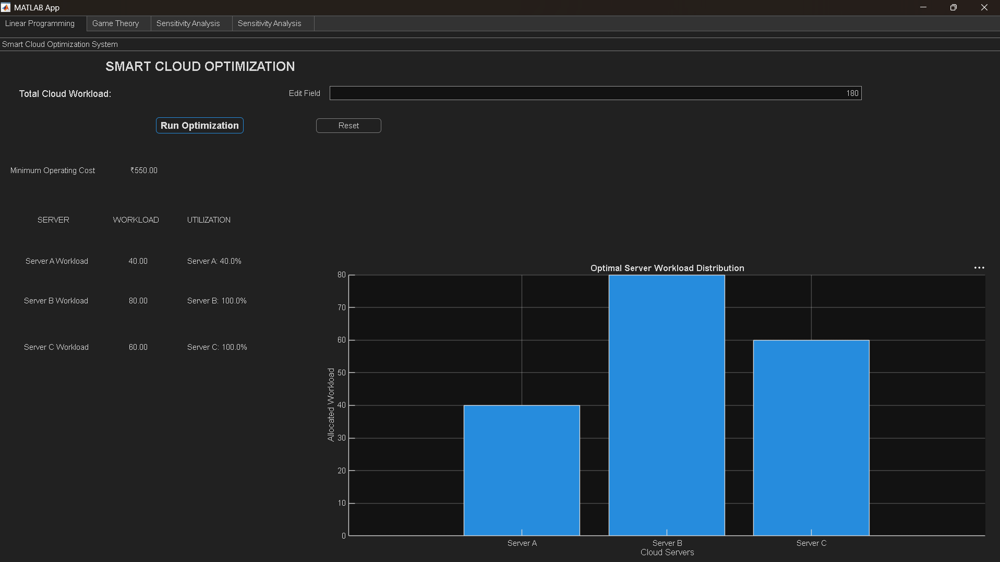
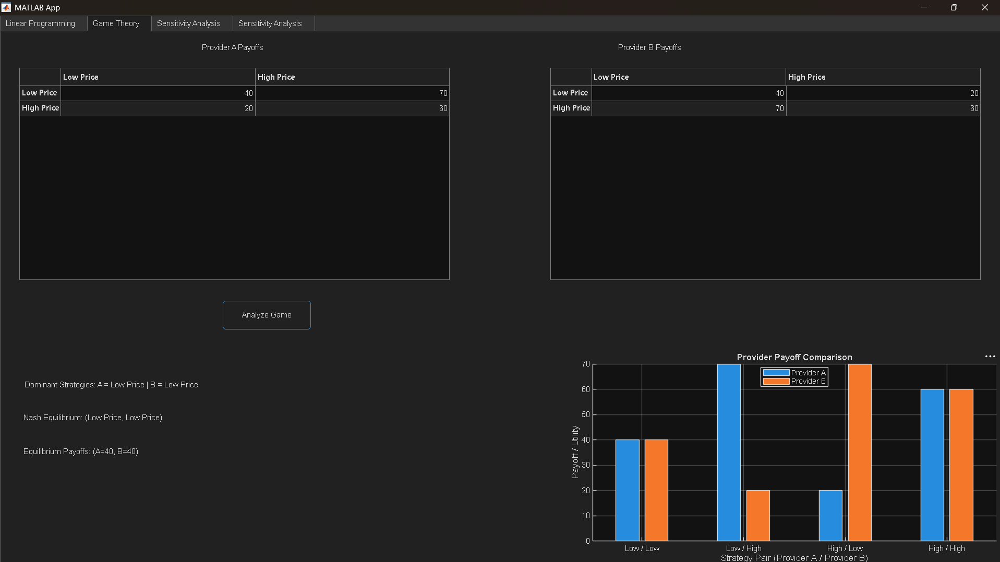
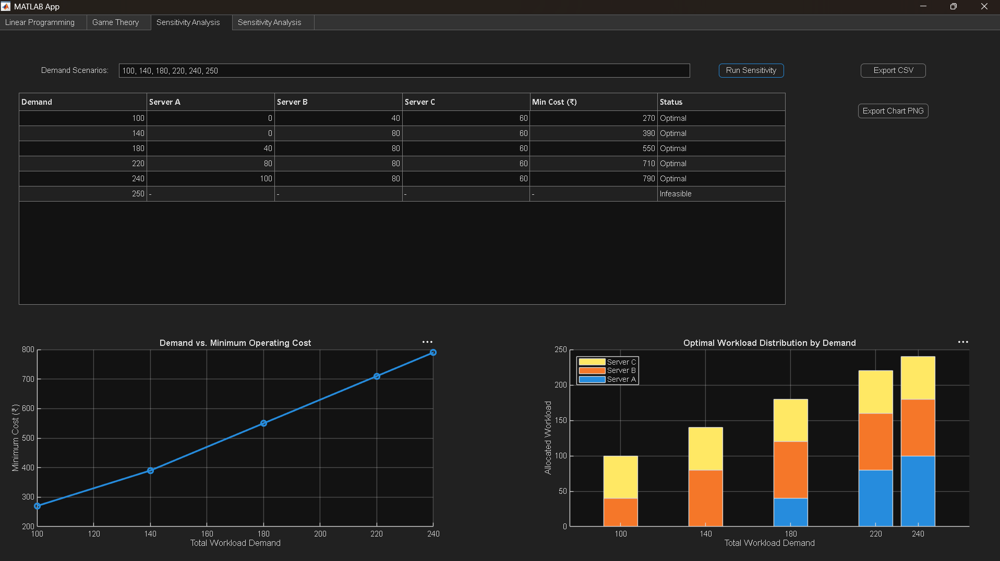

# Smart Cloud Resource Allocation and Competitive Strategy Optimization

A medium-level B.Tech IT project demonstrating Linear Programming (LP) and Game Theory using MATLAB.

## Project modules
1. **Linear Programming:** Minimize workload allocation cost subject to server capacities and total demand.
2. **Game Theory:** Analyze best responses, strict dominant strategies, and pure-strategy Nash equilibria for a two-provider pricing game.
3. **Sensitivity analysis:** Re-solve the LP under different demand levels.
4. **Visualization:** Save workload, cost, utilization, and payoff charts.

All sample numbers are illustrative educational values, not real cloud-provider prices or measured market data.

## Application Screenshots

### Linear Programming Tab


### Game Theory Tab


### Sensitivity Analysis Tab


## Requirements
- MATLAB
- Optimization Toolbox for `linprog`

## Run the project
1. Extract the project folder.
2. Open MATLAB and set the Current Folder to `SmartCloudOptimization`.
3. Run the command-line pipeline:
   ```matlab
   main